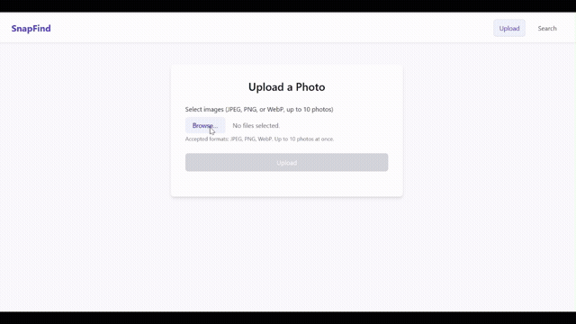
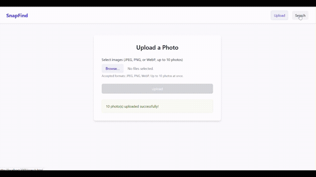
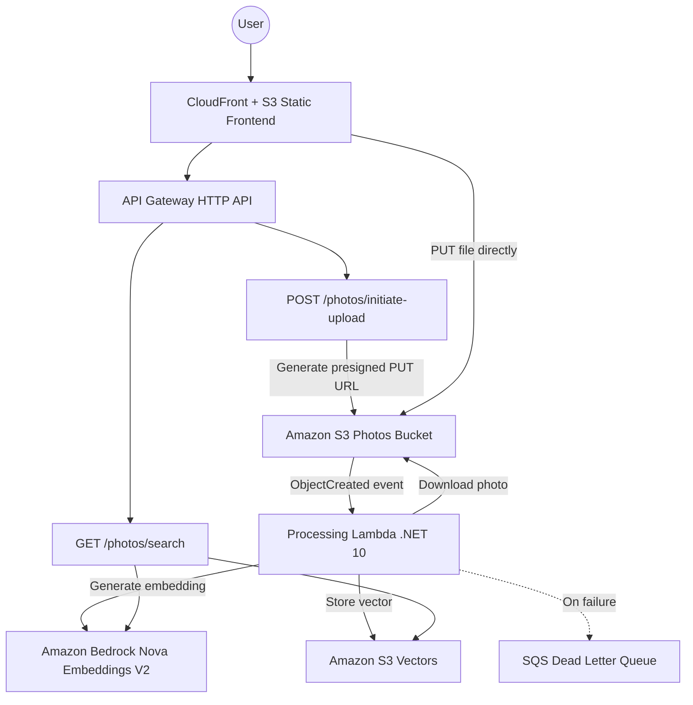
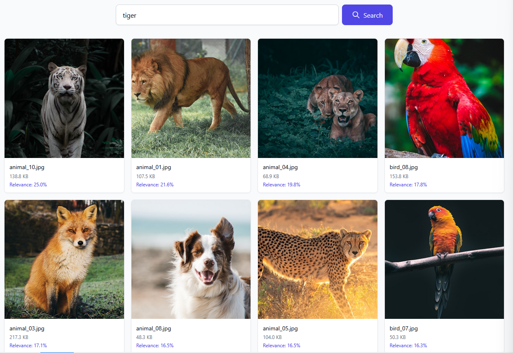

# SnapFind — Serverless Photo Sharing with AI-Powered Semantic Search

A serverless photo sharing app that lets users upload photos and find them using natural language text or by uploading a reference image. Built with .NET 10 on AWS Lambda, powered by Amazon Bedrock Nova Multimodal Embeddings and Amazon S3 Vectors. Uses presigned S3 URLs for direct uploads (up to 25 MB) and event-driven processing for asynchronous embedding generation.

> **Purpose:** Demonstrates Amazon S3 Vectors for semantic search using .NET 10, with a production-style presigned upload and event-driven processing architecture. See [Limitations](#limitations) for what's intentionally left out.

## Demo

### Upload images


### Semantic Search


## Architecture



## How It Works

1. **Upload** — Select up to 10 photos → API returns presigned S3 PUT URLs → client uploads directly to S3 (up to 25 MB each) → S3 returns 200 OK → user sees immediate success
2. **Background Processing** — S3 ObjectCreated event triggers Processing Lambda → downloads photo → Bedrock generates 1024-dim vector embedding → stored in S3 Vectors (photos become searchable within seconds)
3. **Text Search** — Type a query → converted to vector → S3 Vectors returns similar photos ranked by relevance
4. **Image Search** — Upload a reference image → converted to vector → S3 Vectors returns visually similar photos

The upload and processing are fully decoupled. The client never waits for embedding generation — S3 PUT confirmation is the upload confirmation. Failed processing events route to a Dead Letter Queue for investigation without data loss.

## Tech Stack

| Layer | Technology |
|-------|-----------|
| Frontend | HTML + Tailwind CSS + Vanilla JS |
| API Backend | .NET 10 Minimal API on Lambda |
| Processing Backend | .NET 10 Lambda (event-driven) |
| Embeddings | Amazon Bedrock Nova Multimodal Embeddings V2 |
| Vector Storage | Amazon S3 Vectors |
| Photo Storage | Amazon S3 (presigned PUT uploads) |
| Dead Letter Queue | Amazon SQS |
| Infrastructure | AWS CDK (C#) |
| Local Dev | .NET Aspire AppHost |
| Telemetry | OpenTelemetry |

## Prerequisites

- [.NET 10 SDK](https://dotnet.microsoft.com/download/dotnet/10.0)
- [AWS CDK CLI](https://docs.aws.amazon.com/cdk/v2/guide/getting-started.html) (v2+)
- [AWS CLI](https://aws.amazon.com/cli/) configured with credentials
- Amazon Bedrock Nova Multimodal Embeddings model enabled in your account

## Project Structure

```
├── frontend/                          # Static frontend (HTML/CSS/JS)
├── src/
│   ├── PhotoSharingApp.Api/          # Minimal API Lambda (upload initiation + search)
│   ├── PhotoSharingApp.Processing/   # Processing Lambda (S3 event → embeddings)
│   ├── PhotoSharingApp.AppHost/      # Aspire local dev orchestrator
│   └── PhotoSharingApp.ServiceDefaults/ # Shared service configuration
├── infra/                             # AWS CDK stacks (Backend + Frontend)
└── tests/                             # Unit + property-based tests
```

## Local Development

```bash
# Install frontend dependencies and build CSS (first time only)
cd frontend && npm install && npm run build:css && cd ..

# Run the app
dotnet run --project src/PhotoSharingApp.AppHost
```

Opens the Aspire dashboard with API + frontend running locally. The API calls real AWS services — ensure your credentials are configured and CDK stacks are deployed.

Requires [Node.js](https://nodejs.org/) for the frontend static server.

## Deployment

```bash
# Bootstrap CDK (first time only)
cd infra
cdk bootstrap
cd ..

# Build both Lambdas
dotnet publish src/PhotoSharingApp.Api -c Release
dotnet publish src/PhotoSharingApp.Processing -c Release

# Deploy all CDK stacks (CORS is automatically configured using the CloudFront domain)
cd infra
cdk deploy --all --require-approval never
cd ..

# Install frontend dependencies, build CSS, and update config.js with the API URL from CDK output
cd frontend && npm install && npm run build:css && cd ..
# Edit frontend/config.js — replace the apiBaseUrl with your API Gateway URL

# Sync frontend to S3
aws s3 sync frontend/ s3://FRONTEND-BUCKET --delete --exclude "node_modules/*"
aws cloudfront create-invalidation --distribution-id DIST-ID --paths "/*"
```

## API Endpoints

| Method | Path | Description |
|--------|------|-------------|
| POST | `/photos/initiate-upload` | Get presigned URL(s) for direct S3 upload (single or batch up to 10) |
| POST | `/photos` | Upload photos (legacy multipart, up to 10 files, 6 MB limit) |
| GET | `/photos/search?q={query}` | Text-based semantic search |
| POST | `/photos/search-by-image` | Image-based similarity search |
| GET | `/photos/{id}` | Get photo (302 → presigned URL) |

## Cost

> **Important:** This sample creates AWS resources that incur costs. Ensure you run the [Cleanup](#cleanup) steps after testing to avoid unexpected charges.

All services are serverless/pay-per-use. At low traffic, costs are near zero.

| Service | Pricing |
|---------|---------|
| **S3 Vectors** — Storage | $0.06/GB/month |
| **S3 Vectors** — PUT operations | $0.20/GB uploaded |
| **S3 Vectors** — Query API calls | $0.0025 per 1,000 requests |
| **S3 Vectors** — Query data processed | $0.004/TB (first 100K vectors), $0.002/TB (over 100K) |
| **Bedrock** — Nova Embeddings | ~$0.0006 per image |
| **S3** — Storage | Standard S3 rates |
| **Lambda / API Gateway** | Free tier covers low usage |

For a small app with 1,000 photos and 10K queries/month, expect **< $1/month** total for S3 Vectors. See [AWS S3 Vectors pricing](https://aws.amazon.com/s3/pricing/) for details.

## FAQ: Understanding Search Relevance



### Q: Why does the tiger image have a low relevance score (25%) when it's an exact match?

The relevance percentages are **cosine similarity** values between the text query embedding and the image embedding. With Bedrock Nova Multimodal Embeddings, cross-modal (text→image) scores are inherently lower than same-modal comparisons because text and images are fundamentally different modalities projected into the same 1024-dimensional vector space. Key points:

- A score of **25% being the top result is normal** — it doesn't mean the match is poor. It means this image is the closest to the text "tiger" among all indexed photos.
- Even a perfect conceptual match (a photo literally of a tiger) won't score 90%+ because the model encodes holistic visual features (color, texture, composition, scene context) — not just a label.
- The relative ordering matters more than absolute scores. The tiger at 25% being ranked #1 above lion at 21.6% is the correct behavior.

**Tip:** More descriptive queries produce higher scores. Try "white tiger in dark forest" instead of just "tiger."

### Q: Why does the parrot rank higher (17.8%) than the cheetah (16.5%)?

The embedding model encodes **visual and semantic similarity**, not taxonomic distance. Several factors explain why a parrot might score closer to "tiger" than a cheetah:

- **Visual salience** — The parrot fills the frame as a single, prominent, high-contrast subject. The cheetah image shows a smaller subject in a complex savanna scene. Models reward clear, distinctive subjects.
- **Color and pattern** — Tigers are known for bold colors and striking patterns. The vibrant parrot shares this "visually striking animal" quality more than a sandy cheetah blending into grass.
- **Image composition** — Close-up, well-lit subjects produce more "decisive" embeddings that align more strongly with text concepts. Distant or busy scenes produce more diffuse embeddings.
- **Semantic clustering** — In the model's training data, concepts like "wild animal," "colorful creature," and "exotic wildlife" create overlapping regions in vector space that don't always align with biological taxonomy.

**This is not keyword matching — it's vector similarity.** The model finds images whose visual embedding is geometrically closest to the text embedding of "tiger" in high-dimensional space.

### Q: Why does image-to-image search return better results than text search?

When you use "Search by Image" (uploading a reference photo), you'll typically see higher relevance scores and more precise results than text search. This is because:

- **Same-modality matching** — Both the query and the indexed items are images, so their embeddings occupy the same region of vector space. The cosine similarity between two image embeddings is naturally higher than between a text embedding and an image embedding.
- **Richer signal** — An image carries thousands of visual features (texture, color palette, spatial layout, lighting) that the model encodes. A text query like "tiger" only provides a single semantic concept.
- **No interpretation gap** — With text, the model must "imagine" what a tiger looks like and project that into image space. With a reference image, there's no translation needed.

**Practical takeaway:** Use image search when you have a reference photo and want visually similar results. Use text search for conceptual/semantic discovery.

### Q: Why is the upload limit 25 MB when S3 supports 5 GB?

S3 presigned PUT URLs support uploads up to 5 GB, so there's no AWS-imposed limit at the presigned URL level. The 25 MB application limit is a deliberate design choice driven by:

- **Lambda memory** — The Processing Lambda (1024 MB) holds the entire image in memory and base64-encodes it for Bedrock. A 25 MB image becomes ~33 MB in base64, keeping total memory usage well within bounds.
- **Bedrock input constraints** — Embedding models have practical input size limits. Larger images don't produce better embeddings and increase latency and cost.
- **Cost control** — Larger files mean more S3 storage, more data transfer, and longer Bedrock processing time per photo.
- **UX guardrail** — 25 MB covers high-resolution photos from any modern camera or phone. Anything larger is typically a RAW or uncompressed format unsuitable for a sharing app.
- **4x improvement** — The previous 6 MB limit (API Gateway payload constraint) is already eliminated; 25 MB provides generous headroom for real-world use.

### Q: Why doesn't duplicate upload create duplicate vectors?

The Processing Lambda implements an **idempotency guard**. Before downloading the photo or calling Bedrock, it queries S3 Vectors for the photoId. If a vector already exists, it skips all processing and returns successfully. This means:

- **Duplicate S3 events** (which S3 can deliver in rare cases) are handled gracefully — no redundant Bedrock calls or wasted compute.
- **Re-uploading the same photo** to the same S3 key won't create a second vector entry.
- **Cost protection** — Bedrock embedding calls (~$0.0006/image) and Lambda execution time are not wasted on already-processed photos.

The check is a single `GetVectors` call (fast, cheap) and happens before any expensive operations.

## Limitations

- **No authentication** — Open access, no rate limiting
- **No thumbnails** — Full-size images served via presigned URLs
- **Single-region** — Targets `us-east-1`
- **Eventual consistency** — Photos become searchable ~5-10 seconds after upload (async processing)

## Production Recommendations

- Add **authentication** (Cognito / JWT authorizer)
- Generate **thumbnails** for search results
- Add **content moderation** (Rekognition) and rate limiting
- Add **DLQ alarm** (CloudWatch) to alert on processing failures

## Cleanup

To avoid ongoing charges, destroy all deployed resources:

```bash
cd infra
cdk destroy --all
```

This removes all Lambda functions, S3 buckets (including photos), API Gateway, SQS queue, and CloudFront distribution.

## Security

See [CONTRIBUTING](CONTRIBUTING.md#security-issue-notifications) for more information.

## License

This library is licensed under the MIT-0 License. See the LICENSE file.